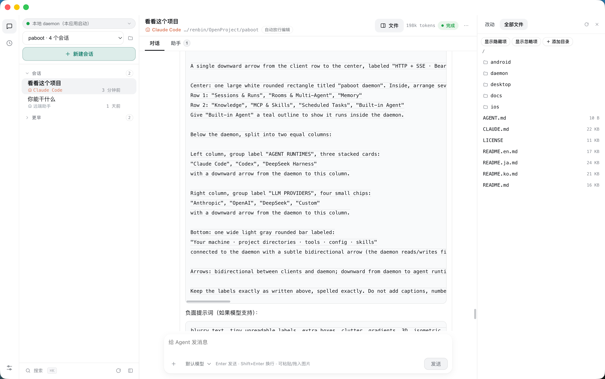
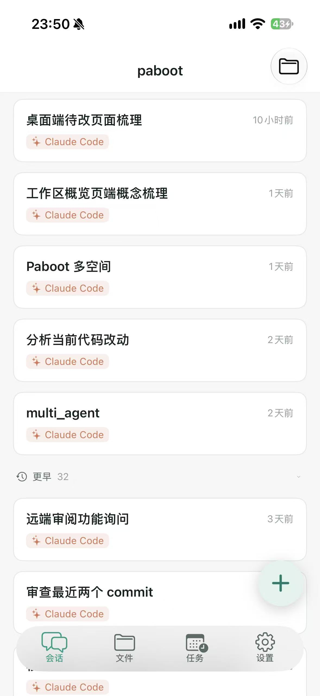
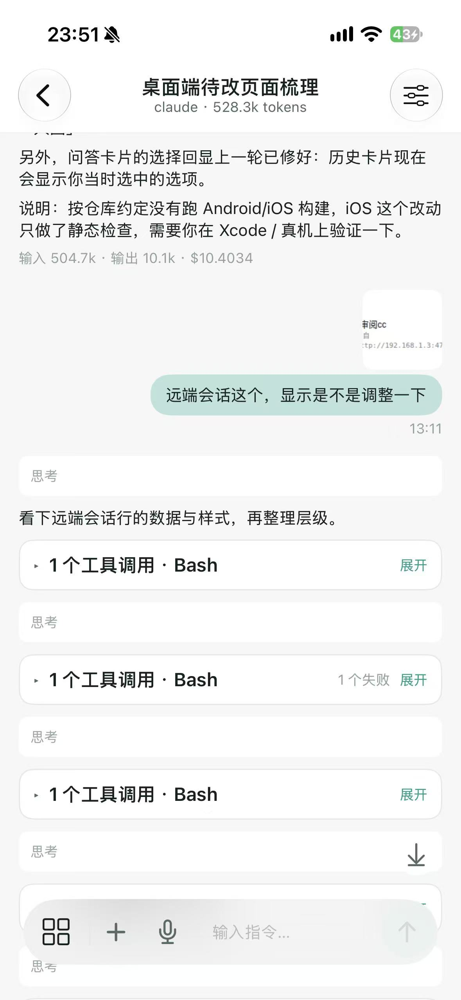
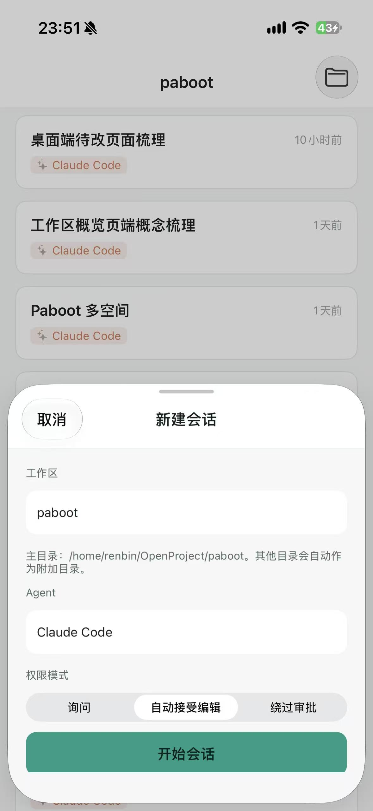
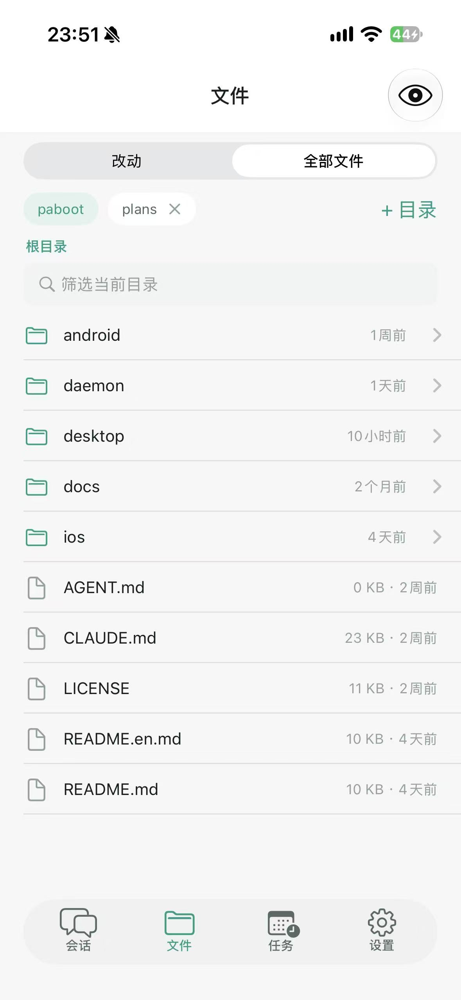
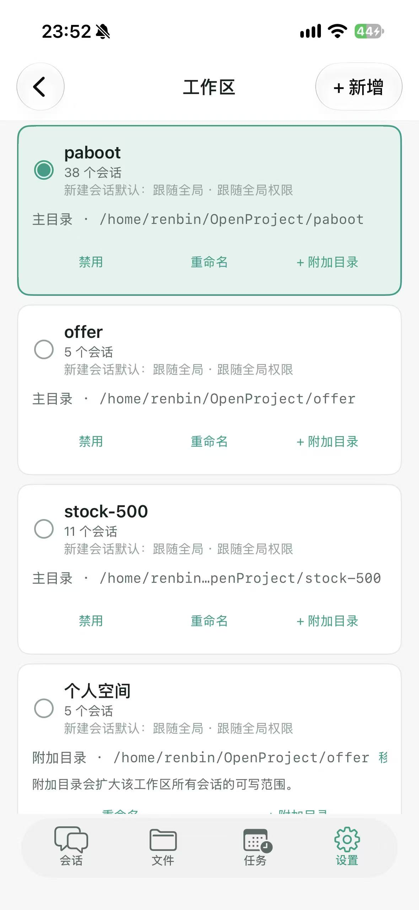
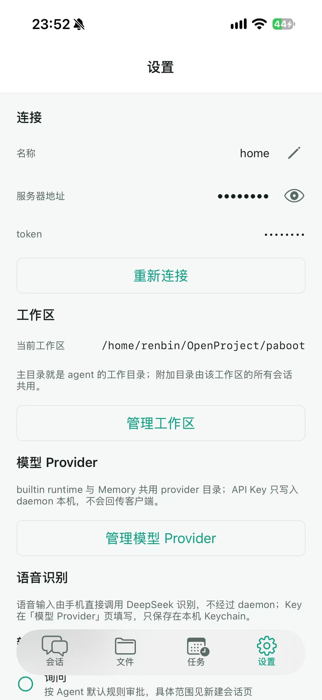

<p align="center">
  English | <a href="README.md">中文</a> | <a href="README.ja.md">日本語</a> | <a href="README.ko.md">한국어</a>
</p>

<h1 align="center">paboot</h1>

<h4 align="center">Build your personal agent for coding, socializing, and daily life</h4>

<p align="center">
  <a href="https://github.com/noResign/paboot/releases/latest"></a>
  <a href="https://www.npmjs.com/package/@noresign/paboot"></a>
  <a href="LICENSE"></a>
  <a href="https://github.com/noResign/paboot/stargazers"></a>
</p>

<p align="center">
  <a href="#quick-start">🚀 Quick Start</a> &nbsp;·&nbsp;
  <a href="daemon/docs/daemon.md">📖 Docs</a> &nbsp;·&nbsp;
  <a href="https://github.com/noResign/paboot/releases">💻 Download</a> &nbsp;·&nbsp;
  <a href="android/README.md">📱 Android</a> &nbsp;·&nbsp;
  <a href="ios/README.md">🍎 iOS</a> &nbsp;·&nbsp;
  <a href="desktop/README.md">🖥️ Desktop</a>
</p>

<br/>

**paboot is a personal agent that runs on your own computer**: it can drive multiple agents and
multiple models, and your phone, tablet and desktop all connect to the same one. It remembers you
(memory), knows your material (knowledge), can pull several assistants into one conversation
(group chat), and ships with tools and skills. **Your data always stays on your own machine**:
open source, no account, no data collection; runs execute on your computer.

<p align="center">
  
</p>

<p align="center"><em>Desktop: activity bar · session list · conversation · file panel</em></p>

<br/>

## 🌟 Highlights

| Capability | Description |
| :--- | :--- |
| Multi-Agent | Claude Code, Codex, DeepSeek Harness and a built-in agent behind one client; define multiple assistants per workspace |
| Group chat | A session is a room: `@` decides who answers, assistants can summon and report back, and assistants can be shared across machines (desktop today) |
| Memory | Facts, preferences, relationships and open loops distilled from conversations, deduplicated and injected into context |
| Knowledge | A verifiable Markdown knowledge base with review status, indexing and context injection |
| Tools & Skills | Built-in file, Bash, web, question and todo tools, plus MCP servers and skills |
| Multi-model | Built-in Anthropic / OpenAI / DeepSeek templates and any OpenAI-compatible provider, selectable per session |
| Multi-client | Native Android / iOS / desktop clients sharing one protocol and one design system |
| Built-in agent | No external CLI required — one model API key is enough |
| Disconnect-safe | Runs are decoupled from connections; locking the phone, switching apps or losing the network does not stop work |
| Approvals | Per-session `ask` / `acceptEdits` / `bypass`, deny by default, auto-denied on timeout |
| Scheduled tasks | In-daemon scheduling, AI-authored task config, cron triggers and session resume |
| File changes | Git changes / diffs / directory tree / text and media previews; your index and HEAD are never touched |
| Anywhere | The desktop app bundles a daemon; npm / Docker deploy to any computer or server |

<br/>

## Quick Start

Pick the way that fits your setup:

| Way | Best for | Entry |
| :--- | :--- | :--- |
| **Desktop (recommended)** | Zero setup, no Node / CLI required | [Download](https://github.com/noResign/paboot/releases) |
| **daemon + phone** | An always-on computer, phone / tablet access | `npm install -g @noresign/paboot` |
| **Docker** | A server / NAS | [daemon/docker-compose.yml](daemon/docker-compose.yml) |
| **From source** | Development | See "Build clients from source" below |

### 0. Prerequisites

paboot drives Claude Code, Codex and DeepSeek Harness, plus a **built-in agent**. The external
agents have to be installed and configured **on the machine that runs the daemon**; the built-in one
needs no CLI — only a model provider API key (see "Multi-Agent & group chat" below).

> [Codex CLI](https://developers.openai.com/codex/cli) and run `codex login`
>
> [Claude Code](https://code.claude.com/docs) and run `claude auth login`
>
> [DeepSeek Harness](https://github.com/deepseek-ai/deepseek-harness): `npm install -g @deepseek-ai/dsh`;
> provide model credentials through the `DEEPSEEK_API_KEY` environment variable, or fill them in
> under **Settings → Models** in `dsh web`.

### 1. Desktop (recommended: it can run the daemon itself)

Install an installer from the [releases](https://github.com/noResign/paboot/releases) page and open
it. The desktop app ships a daemon runtime: if no daemon is running, it starts one automatically
(auto-start can be turned off in Settings), so **you do not need Node / npm**.

- After connecting, the app opens the built-in **Personal** workspace; add or switch project
  directories under **Settings → Workspaces**;
- Android / iOS on the same network can connect to that daemon too: use the LAN address shown by the
  desktop app and the token at `~/.paboot/token`.

### 2. Standalone daemon (any computer or server)

The daemon is a headless back end exposed over HTTP/SSE, so it can live on any machine and serve any
client.

**npm**

```bash
npm install -g @noresign/paboot      # the global command is `paboot`

paboot --workspace /path/to/your/project
# without --workspace the daemon opens the built-in Personal workspace (~/.paboot/life)
```

- The token is persisted at `~/.paboot/token` (delete the file to rotate); pass
  `--token` to set your own
- Full flags, configuration, and the HTTP/SSE API live in
  [daemon/README.md](daemon/README.md)

**Docker**

```bash
cd daemon
PABOOT_UID=$(id -u) PABOOT_GID=$(id -g) docker compose up -d --build

# the image ships no agent CLI — install the one you use
docker exec -it paboot npm i -g @anthropic-ai/claude-code
docker compose restart daemon
```

- Token: `docker exec paboot cat /home/paboot/.paboot/token`
- Mounting a host project, authentication and publishing the image: see
  [daemon/docs/docker.md](daemon/docs/docker.md)

### 3. Build clients from source

**(1) desktop**

```bash
cd daemon && pnpm install && cd ..
cd desktop && pnpm install
```

Commands and build details live in [desktop/README.md](desktop/README.md).

**(2) android**

```bash
cd android
./gradlew :app:assembleAlphaDebug
```

Two channels: `alphaDebug` (alpha) and `prodDebug` (prod); release signing needs
`android/keystore.properties`. Module layout and signing notes live in
[android/README.md](android/README.md).

**(3) ios**

```bash
cd ios
xcodebuild -project paboot.xcodeproj -scheme paboot \
  -destination 'generic/platform=iOS Simulator' build CODE_SIGNING_ALLOWED=NO
```

Module layout and the pure-logic tests (`ios/PabootCore`) live in [ios/README.md](ios/README.md).

<br/>

## 👥 Multi-Agent & group chat

paboot makes "which agent answers" composable: a session can have a single lead agent, or pull
several assistants into the same room.

### Agent runtimes

| Runtime | Integration | Notes |
| :--- | :--- | :--- |
| Claude Code | external CLI | install locally and run `claude auth login` |
| Codex | external CLI (`codex app-server`) | install locally and run `codex login` |
| DeepSeek Harness | external CLI (`dsh acp`) | install locally and configure model credentials |
| Built-in agent | inside the daemon process | no CLI, just a model API key |

**The built-in agent works out of the box**: it lives inside the daemon and brings its own tools,
MCP, skills, image input and context compaction.

### Assistants and rooms

- **Workspace-level assistants**: each workspace can define multiple assistants with their own
  runtime, model, system definition and read-only ceiling; read-only assistants get no write tools,
  and a room has at most one writable agent.
- **Group chat**: `@name` addresses specific members, `@all` broadcasts to available ones, and
  with no mention the lead agent answers. Tasks in one turn run concurrently, while tasks for the
  same agent queue serially.
- **Cross-machine sharing**: expose an assistant through an invite link, and another paboot can
  `@` it from its own sessions (trusted-network mode, deny by default).

<br/>

## 🧠 Memory & knowledge

### Memory

paboot captures conversations from life sessions (and dev workspaces with memory enabled), then a
shared LLM extracts facts, preferences, relationships, profiles and open loops in the background.
After deduplication, conflict resolution and entity merging, memory is injected into context on a
budget and can also be queried on demand through the memory tool.

- Memory and injection can be toggled per workspace; the Personal workspace is on by default,
  project workspaces are off by default.
- Cross-workspace read policy, retrieval ladder, timeline and search, follow-up review and
  per-item feedback are supported.
- Clients can view, correct and forget; write tools go through approval.

See [daemon/docs/memory.md](daemon/docs/memory.md).

### Knowledge

Markdown documents in a workspace form a verifiable knowledge base: each entry has a title, body
and `.meta.json` metadata (source, review status, hash). Confirmed entries are injected into
context as pointers, their bodies are read on demand, and the whole base can be exported as a zip.

- Organized per workspace, with optional external directories; scanning and indexing happen inside
  the daemon.
- Desktop can create, edit, verify and delete; mobile can view and toggle verification. Knowledge
  changes sync into the memory index.
- Files are the source of truth; the index is rebuildable.

See [daemon/docs/knowledge.md](daemon/docs/knowledge.md).

<br/>

## 🔧 Tools & skills

The built-in agent ships with its own tools; external agents keep using their own toolchains.

| Category | Contents |
| :--- | :--- |
| Files | `Read` / `Write` / `Edit` / `Grep` / `Glob` |
| Shell | `Bash` (read-only allowlist auto-allowed; writes require approval) |
| Web | `WebSearch` (provider-hosted) / `WebFetch` (provider-hosted or local direct backend) |
| Interaction | `AskUserQuestion` (blocking question) / `TodoWrite` |
| Extension | MCP servers (stdio), skills (`SKILL.md` directories), image input |

<br/>

## 📱 Clients

All three clients are native and share the `daemon/src/types/api.ts` transport contract and the
`docs/ui/` design system.

| Client | Stack | Implemented |
| :--- | :--- | :--- |
| Android | Kotlin + Jetpack Compose | connect / sessions / chat / approvals / files / workspaces / scheduled tasks / knowledge (view / verify) / memory |
| iOS | UIKit + SwiftPM | connect / sessions / chat / approvals / files / workspaces / scheduled tasks / knowledge (view / verify) / memory |
| Desktop | Electron + React | all of the above + multi-agent group chat / assistant management / global tasks / cross-machine sharing / skins |

### Mobile UI

| Sessions | Chat (Markdown) | New session |
|---|---|---|
|  |  |  |

| Files & diff | Workspaces | Settings |
|---|---|---|
|  |  |  |

<br/>

## 🔐 Security & permissions

Driving a shell-capable agent from a client is effectively remote code execution. paboot defaults
to deny:

- **Authentication**: apart from `/health` and the peer handshake endpoints, every route requires a
  Bearer token; the token is persisted at `~/.paboot/token` (delete to rotate), and repeated
  failures from one source trigger a cooldown.
- **Permission modes**: per-session `ask` / `acceptEdits` / `bypass`; under `ask`, Bash / Write /
  Edit and MCP calls require approval, timeouts deny, and read-only commands are auto-allowed.
- **Scopes**: approvals and "allow all" grants are session-level; the workspace boundary constrains
  writes, not an OS sandbox. Reads outside the workspace are neither gated nor added to the cwd.
- **Data**: SQLite / token / memory / knowledge / providers live under `~/.paboot`; paboot needs no
  account and collects no data.
- **Peers**: peer mode trusts the other machine; `~/.paboot` is best-effort denied rather than
  sandboxed, and only builtin / Claude agents can be shared.

> ⚠️ Exposing the daemon to the internet is handing a shell-capable machine to anyone who can
> connect. Prefer Tailscale / ZeroTier / WireGuard; use an SSH tunnel only temporarily, and never
> leak your IP or token.

<br/>

## 🌐 Remote access (optional)

By default the daemon only listens on your LAN. To reach it from outside, two common approaches:

**(1) SSH relay** — for personal use. You need one machine with a public IP. On the **computer
running the daemon**:

```bash
ssh -N -R 0.0.0.0:4788:localhost:4780 user@your-server
```

Then point your phone at `http://your-server:4788`. Note that **SSH only encrypts the
"computer → server" leg; the hop from the phone to the server is still plain HTTP**, so the token
travels in the clear there — which is why this route is only for temporary use.

- The command binds `0.0.0.0`, but the server ignores that and binds to **loopback** by default, so
  the phone still cannot reach it. Set `GatewayPorts clientspecified` in the server's
  `/etc/ssh/sshd_config`
- The tunnel does not reconnect by itself; use `autossh -M 0 -N -R ...` or run it under systemd

**(2) Mesh / VPN tools** — put the computer and the phone on the same virtual network, then connect
to the address the daemon printed (or its virtual IP) exactly as if you were on the same LAN.
Nothing to change on the daemon side:

- **Tailscale / ZeroTier** — sign in and go; mobile apps included, with a relay fallback when NAT
  traversal fails
- **WireGuard** — roll your own; cleanest, but you maintain the keys and routes

The whole path is encrypted end to end, so there is no certificate or port exposure to worry about.

<br/>

## 🛠️ Development & contributing

- Repository layout and conventions live in [CLAUDE.md](CLAUDE.md); each subproject has its own README.
- daemon: `cd daemon && pnpm install && pnpm dev`; before committing run
  `pnpm typecheck && pnpm test`.
- Desktop: `cd desktop && pnpm dev`; Android uses Android Studio; iOS opens
  `ios/paboot.xcodeproj` in Xcode.
- When a change touches the protocol, update `daemon/src/types/api.ts` and the three clients' DTOs.
  Issues and PRs are welcome.

<br/>

## ⚠️ Disclaimer

1. Released under [Apache-2.0](LICENSE), provided as-is without warranty of any kind.
2. The agent can access your local filesystem and shell; only deploy it in trusted environments and
   use it at your own risk.
3. Comply with the laws and regulations of your jurisdiction; the maintainers assume no liability
   for consequences arising from use of this project.

<br/>

## License

Apache-2.0 — see [LICENSE](LICENSE).
