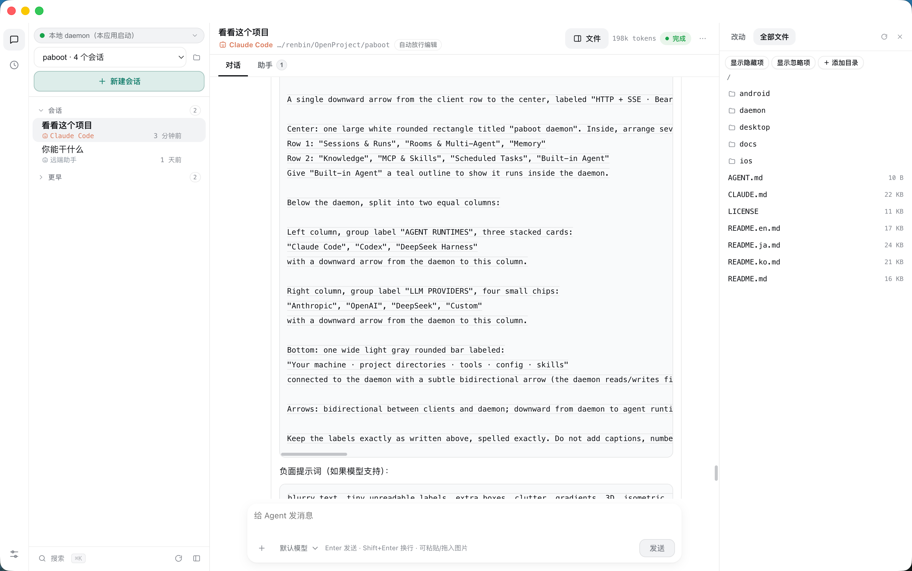
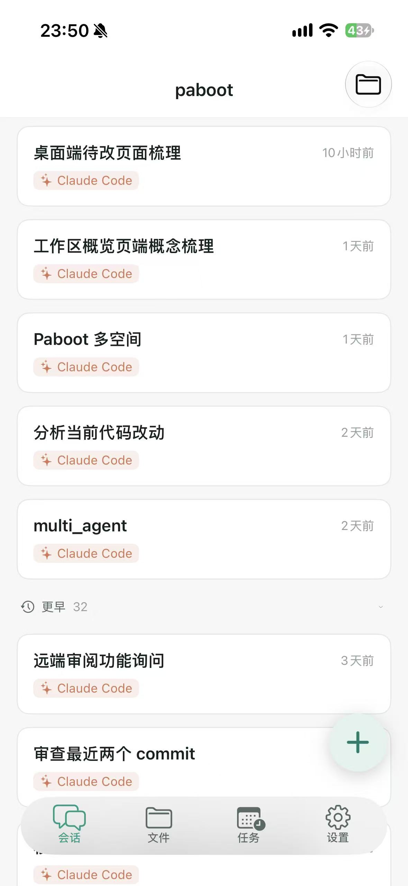
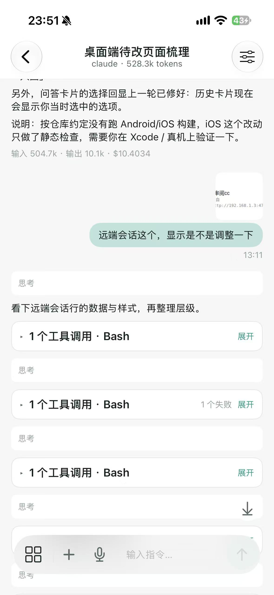
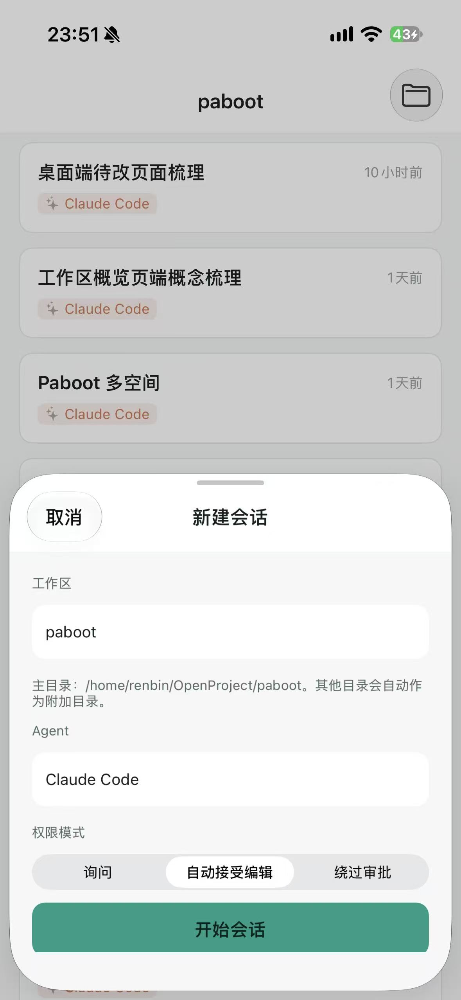
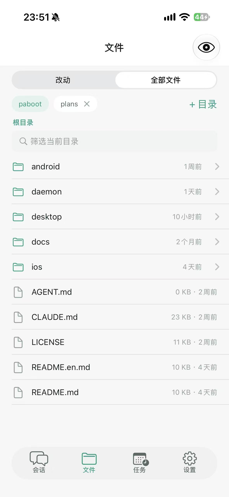
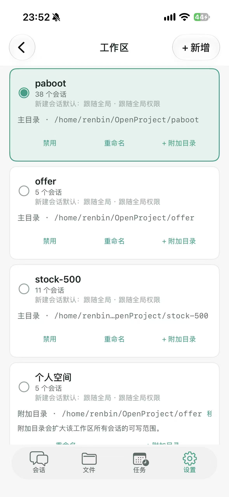
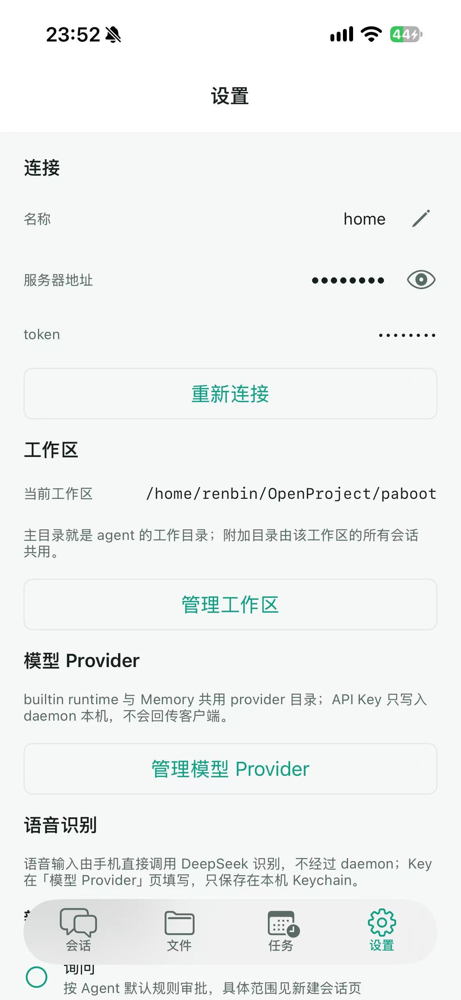

<p align="center">
  <a href="README.en.md">English</a> | <a href="README.md">中文</a> | 日本語 | <a href="README.ko.md">한국어</a>
</p>

<h1 align="center">paboot</h1>

<h4 align="center">コーディング、交流、日常生活のためのパーソナルエージェント</h4>

<p align="center"><em>Build your personal agent for coding, socializing, and daily life.</em></p>

<p align="center">
  <a href="https://github.com/noResign/paboot/releases/latest"></a>
  <a href="https://www.npmjs.com/package/@noresign/paboot"></a>
  <a href="LICENSE"></a>
  <a href="https://github.com/noResign/paboot/stargazers"></a>
</p>

<p align="center">
  <a href="#クイックスタート">🚀 クイックスタート</a> &nbsp;·&nbsp;
  <a href="daemon/docs/daemon.md">📖 ドキュメント</a> &nbsp;·&nbsp;
  <a href="https://github.com/noResign/paboot/releases">💻 ダウンロード</a> &nbsp;·&nbsp;
  <a href="android/README.md">📱 Android</a> &nbsp;·&nbsp;
  <a href="ios/README.md">🍎 iOS</a> &nbsp;·&nbsp;
  <a href="desktop/README.md">🖥️ デスクトップ</a>
</p>

<br/>

**paboot は、あなたのコンピュータ上で動くパーソナルエージェントです**：複数のエージェントと
複数のモデルを駆動でき、スマートフォン、タブレット、デスクトップから同じ 1 つに接続できます。
あなたを記憶し（メモリ）、あなたの資料を理解し（ナレッジ）、複数のアシスタントを同じ会話に
招いて協働させ（グループチャット）、ツールとスキルも備えています。**データは常にあなたの
マシン上に**：オープンソースで、アカウント登録は不要、データも収集しません。セッションは
あなたのコンピュータ上で実行されます。

<p align="center">
  
</p>

<p align="center"><em>デスクトップ：アクティビティバー · セッション一覧 · 会話 · ファイルパネル</em></p>

<br/>

## 🌟 ハイライト

| 機能 | 説明 |
| :--- | :--- |
| マルチエージェント | Claude Code、Codex、DeepSeek Harness、組み込みエージェントを 1 つのクライアントに。ワークスペースごとに複数のアシスタントを定義可能 |
| グループチャット | 1 つのセッションが 1 つのルーム。`@` で回答者を指定し、アシスタント同士が呼び出し・報告。マシン間共有にも対応（現在はデスクトップ） |
| メモリ | 会話から事実・好み・関係・未完了タスクを抽出し、重複排除と競合解決を経てコンテキストに注入 |
| ナレッジ | 検証可能な Markdown ナレッジベース。レビュー状態、インデックス検索、コンテキスト注入に対応 |
| ツールとスキル | ファイル、Bash、Web、質問、Todo などの組み込みツール。MCP サーバーとスキルに対応 |
| マルチモデル | Anthropic / OpenAI / DeepSeek のテンプレートと、任意の OpenAI 互換プロバイダー。セッションごとに切り替え |
| マルチクライアント | Android / iOS / デスクトップのネイティブ実装。1 つのプロトコルと 1 つのデザインシステムを共有 |
| 組み込みエージェント | 外部 CLI 不要。モデルの API キー 1 つで動作 |
| 切断後も継続 | run と接続を分離。画面ロック、アプリ切り替え、ネットワーク切断でもコンピュータ上のタスクは止まらない |
| 承認 | セッションごとに `ask` / `acceptEdits` / `bypass`。デフォルト拒否、タイムアウトで自動拒否 |
| スケジュールタスク | daemon 内でスケジュール。AI 設定セッションがタスクを作成し、cron で起動してセッションを再開 |
| ファイル変更 | Git の変更 / diff / ディレクトリツリー / テキスト・メディアのプレビュー。index / HEAD には触れない |
| どこでもデプロイ | デスクトップは daemon を内蔵。npm / Docker で任意のコンピュータやサーバーにデプロイ可能 |

<br/>

## クイックスタート

paboot にはいくつかの使い方があります。環境に合わせて選んでください：

| 方法 | 向いている用途 | 入口 |
| :--- | :--- | :--- |
| **デスクトップ（推奨）** | Node / CLI を入れたくない、すぐ使いたい | [インストーラー](https://github.com/noResign/paboot/releases) |
| **daemon + スマートフォン** | 常時起動のコンピュータにスマホ / タブレットから接続 | `npm install -g @noresign/paboot` |
| **Docker** | サーバー / NAS にデプロイ | [daemon/docker-compose.yml](daemon/docker-compose.yml) |
| **ソースからビルド** | 開発に参加 | 下記「クライアントをソースからビルド」 |

### 0. 前提

paboot は Claude Code / Codex / DeepSeek Harness と**組み込みエージェント**に対応しています。
外部エージェントは**daemon を実行するマシン**に事前にインストールして設定する必要があります。
組み込みエージェントは CLI 不要で、モデルプロバイダーの API キーだけあれば動きます（下記
「マルチエージェントとグループチャット」参照）。

> [Codex CLI](https://developers.openai.com/codex/cli) and run `codex login`
>
> [Claude Code](https://code.claude.com/docs) and run `claude auth login`
>
> [DeepSeek Harness](https://github.com/deepseek-ai/deepseek-harness)：`npm install -g @deepseek-ai/dsh`；モデル認証情報は
> `DEEPSEEK_API_KEY` 環境変数、または `dsh web` の「設定 → モデル」で入力します。

### 1. デスクトップ（推奨：デスクトップ自体が daemon を起動できます）

[releases](https://github.com/noResign/paboot/releases) からインストーラーをダウンロードして
開きます。デスクトップには daemon が内蔵されており、ローカルで daemon が動いていなければ
自動的に起動します（設定で自動起動をオフにできます）。**Node / npm を先に入れる必要は
ありません。**

- 接続後は組み込みの「パーソナル」ワークスペースに入ります。「設定 → ワークスペース」で
  プロジェクトディレクトリを追加・切り替えできます；
- 同じ LAN 上の Android / iOS もこの daemon に接続できます。アドレスはデスクトップに表示
  される LAN アドレス、token は `~/.paboot/token` です。

### 2. daemon を単体でデプロイ（任意のコンピュータ / サーバー）

daemon は HTTP/SSE で公開されるヘッドレスなバックエンドなので、任意のマシンに置いて
任意のクライアントに提供できます。

**npm**

```bash
npm install -g @noresign/paboot      # グローバルコマンド名は paboot

paboot --workspace /path/to/your/project
# --workspace を省略すると、組み込みの「パーソナル」ワークスペース（~/.paboot/life）に入ります
```

- token は `~/.paboot/token` に保存されます（ファイルを削除するとローテーション）。`--token`
  で自分で指定することもできます
- 全オプション、設定、HTTP/SSE API は [daemon/README.md](daemon/README.md) を参照

**Docker**

```bash
cd daemon
PABOOT_UID=$(id -u) PABOOT_GID=$(id -g) docker compose up -d --build

# イメージには agent CLI が含まれていません。使うものをインストールしてください
docker exec -it paboot npm i -g @anthropic-ai/claude-code
docker compose restart daemon
```

- token：`docker exec paboot cat /home/paboot/.paboot/token`
- ホストプロジェクトのマウント、認証、イメージ公開などの詳細は
  [daemon/docs/docker.md](daemon/docs/docker.md) を参照

### 3. クライアントをソースからビルド

**(1) desktop**

```bash
cd daemon && pnpm install && cd ..
cd desktop && pnpm install
```

コマンドとビルドの詳細は [desktop/README.md](desktop/README.md) を参照。

**(2) android**

```bash
cd android
./gradlew :app:assembleAlphaDebug
```

チャンネルは 2 つ：`alphaDebug`（テスト）と `prodDebug`（正式）。正式署名には
`android/keystore.properties` が必要です。モジュール構成と署名の説明は
[android/README.md](android/README.md) を参照。

**(3) ios**

```bash
cd ios
xcodebuild -project paboot.xcodeproj -scheme paboot \
  -destination 'generic/platform=iOS Simulator' build CODE_SIGNING_ALLOWED=NO
```

モジュール構成と純粋ロジックのテスト（`ios/PabootCore`）は [ios/README.md](ios/README.md)
を参照。

<br/>

## 👥 マルチエージェントとグループチャット

paboot は「どのエージェントが答えるか」を組み合わせ可能にします。1 つのセッションに
リードエージェントを 1 つだけ置くことも、複数のアシスタントを同じルームに招いて協働させる
こともできます。

### エージェントランタイム

| ランタイム | 接続方法 | 説明 |
| :--- | :--- | :--- |
| Claude Code | 外部 CLI | ローカルにインストールし `claude auth login` |
| Codex | 外部 CLI（`codex app-server`） | ローカルにインストールし `codex login` |
| DeepSeek Harness | 外部 CLI（`dsh acp`） | ローカルにインストールしモデル認証情報を設定 |
| 組み込みエージェント | daemon プロセス内 | CLI 不要。モデルの API キーだけ |

**組み込みエージェントはすぐ使えます**：daemon プロセス内で動作し、ツール、MCP、スキル、
画像入力、コンテキスト圧縮を備えます。

### アシスタントとルーム

- **ワークスペース単位のアシスタント**：各ワークスペースに複数のアシスタントを定義でき、
  それぞれ runtime、モデル、システム定義、読み取り専用の制約を指定できます。読み取り専用
  アシスタントには書き込みツールが付かず、1 つのルームに書き込み可能なエージェントは最大
  1 つです。
- **グループチャットに対応**：`@名前` で回答者を指定し、`@all` で利用可能な全メンバーに
  ブロードキャストします。`@` がなければリードエージェントが回答します。同じ turn の複数
  タスクは並行実行され、同じエージェントのタスクは直列にキューされます。
- **マシン間共有**：招待リンクでアシスタントを別の paboot に共有し、相手のセッションから
  直接 `@` できます（信頼できるネットワーク前提、デフォルト拒否）。

<br/>

## 🧠 メモリとナレッジ

### メモリ

paboot は life セッション（およびメモリを有効にした dev ワークスペース）から会話を自動的に
取り込み、バックグラウンドで共有 LLM を使って事実、好み、関係、プロフィール、未完了タスク
を抽出します。重複排除、競合解決、エンティティ統合を経て、予算に応じてコンテキストに注入
され、memory ツールからオンデマンドで検索することもできます。

- メモリと注入はワークスペースごとにオン / オフ。パーソナルワークスペースはデフォルトで
  オン、プロジェクトワークスペースはデフォルトでオフです。
- ワークスペース間の読み取りポリシー、検索ラダー、タイムラインと検索、フォローアップの
  レビュー、項目ごとのフィードバックに対応します。
- クライアントから閲覧・修正・忘却が可能。書き込みツールは承認を通ります。

詳細は [daemon/docs/memory.md](daemon/docs/memory.md) を参照。

### ナレッジ

ワークスペース内の Markdown ドキュメントが、検証可能なナレッジベースを構成します。各
エントリにはタイトル、本文、`.meta.json` メタデータ（出典、レビュー状態、ハッシュ）が
あります。confirmed のエントリはポインターとしてコンテキストに注入され、本文は必要に
応じて読み込まれます。zip エクスポートにも対応します。

- ワークスペース単位で整理され、外部ディレクトリも追加可能。スキャンとインデックスは
  daemon 内で実行されます。
- デスクトップでは作成・編集・検証・削除が可能。モバイルでは閲覧と検証マークのみ。
  ナレッジの変更はメモリインデックスに同期されます。
- ファイルが真のソースで、インデックスは再構築可能です。

詳細は [daemon/docs/knowledge.md](daemon/docs/knowledge.md) を参照。

<br/>

## 🔧 ツールとスキル

組み込みエージェントは独自のツール群を備え、外部エージェントはそれぞれのツールチェーンを
使い続けます。

| カテゴリ | 内容 |
| :--- | :--- |
| ファイル | `Read` / `Write` / `Edit` / `Grep` / `Glob` |
| ターミナル | `Bash`（読み取り専用の許可リストは自動許可、書き込みは承認） |
| Web | `WebSearch`（プロバイダー側）/ `WebFetch`（プロバイダー側またはローカル直結の 2 バックエンド） |
| インタラクション | `AskUserQuestion`（ブロッキング質問）/ `TodoWrite` |
| 拡張 | MCP サーバー（stdio）、スキル（`SKILL.md` ディレクトリ）、画像入力 |

<br/>

## 📱 クライアント

3 つのクライアントはすべてネイティブ実装で、`daemon/src/types/api.ts` の通信契約と
`docs/ui/` のデザインシステムを共有します。

| クライアント | 技術スタック | 実装済み |
| :--- | :--- | :--- |
| Android | Kotlin + Jetpack Compose | 接続 / セッション / チャット / 承認 / ファイル / ワークスペース / スケジュールタスク / ナレッジ（閲覧 / 検証）/ メモリ |
| iOS | UIKit + SwiftPM | 接続 / セッション / チャット / 承認 / ファイル / ワークスペース / スケジュールタスク / ナレッジ（閲覧 / 検証）/ メモリ |
| デスクトップ | Electron + React | 上記 + マルチエージェントグループチャット / アシスタント管理 / グローバルタスク / マシン間共有 / スキン |

### モバイル UI

| セッション一覧 | チャット（Markdown） | 新規セッション |
|---|---|---|
|  |  |  |

| Diff / すべてのファイル | ワークスペース管理 | 設定 |
|---|---|---|
|  |  |  |

<br/>

## 🔐 セキュリティと権限

クライアントから shell 権限を持つエージェントを操作することは、実質的にリモートコード
実行です。paboot のデフォルトは「拒否」です：

- **認証**：`/health` と peer の公開ハンドシェイク端点を除き、すべてのルートに Bearer
  token が必要です。token は `~/.paboot/token` に保存され、削除するとローテーション。
  同一ソースからの連続失敗はクールダウンします。
- **権限モード**：セッションごとに `ask` / `acceptEdits` / `bypass`。`ask` では Bash /
  Write / Edit と MCP 呼び出しに承認が必要で、タイムアウトで自動拒否、読み取り専用
  コマンドは自動許可されます。
- **スコープ**：承認と「すべて許可」はセッション単位。ワークスペース境界は書き込みを
  制約するもので、OS サンドボックスではありません。ワークスペース外の読み取りは承認も
  不要で、ディレクトリも自動追加されません。
- **データ**：SQLite / token / メモリ / ナレッジ / providers は `~/.paboot` 配下。paboot は
  アカウント不要でデータを収集しません。
- **マシン間**：peer は「信頼できる相手」モード。`~/.paboot` はサンドボックスではなく
  ベストエフォートで拒否します。共有できるのは builtin / Claude エージェントのみです。

> ⚠️ daemon をインターネットに公開することは、shell を持つマシンを接続できる人に
> 渡すことと同じです。Tailscale / ZeroTier / WireGuard でのメッシュ接続を優先し、
> SSH トンネルは一時的な個人利用に限定してください。IP と token を漏らさないでください。

<br/>

## 🌐 リモートアクセス（任意）

daemon はデフォルトで LAN のみをリッスンします。スマートフォンとコンピュータが同じ
ネットワークにない場合、主に 2 つの方法があります：

**(1) SSH リレー** —— 自用向け。パブリック IP を持つサーバーが 1 台必要です。**daemon を
実行しているコンピュータ**で次を実行します：

```bash
ssh -N -R 0.0.0.0:4788:localhost:4780 user@your-server
```

スマートフォンから `http://your-server:4788` に接続します。注意：**SSH が暗号化するのは
「コンピュータ → サーバー」の区間だけで、スマートフォンからサーバーへの区間は平文 HTTP
のまま**です。その区間では token が平文で流れるため、一時的な利用に限定してください。

- `-R` はデフォルトでサーバーの **loopback** にしかバインドしません。サーバーの
  `/etc/ssh/sshd_config` で `GatewayPorts clientspecified` を設定してください
- トンネルは自動復旧しません。systemd サービスとして常駐させるか、`autossh -M 0 -N -R ...`
  を使ってください

**(2) メッシュ / VPN ツール** —— コンピュータとスマートフォンを同じ仮想ネットワークに
入れれば、同じ LAN にいるのと同じように、daemon が表示したアドレス（または仮想 IP）に
そのまま接続できます。daemon 側の設定変更は不要です：

- **Tailscale / ZeroTier** —— インストールしてログインするだけ。NAT 越えに失敗したときは
  自動でリレーします
- **WireGuard** —— 自分で構築。最もクリーンですが、鍵とルートの管理が必要です

経路全体が暗号化されるため、証明書やポート公開を気にする必要はありません。

<br/>

## 🛠️ 開発と貢献

- リポジトリ構成と開発規約は [CLAUDE.md](CLAUDE.md)。各サブプロジェクトの詳細は各 README。
- daemon：`cd daemon && pnpm install && pnpm dev`。コミット前に
  `pnpm typecheck && pnpm test` を実行してください。
- デスクトップ：`cd desktop && pnpm dev`。Android は Android Studio、iOS は Xcode で
  `ios/paboot.xcodeproj` を開きます。
- プロトコルに関わる変更では `daemon/src/types/api.ts` と 3 クライアントの DTO を同期して
  ください。Issue / PR を歓迎します。

<br/>

## ⚠️ 免責事項

1. 本プロジェクトは [Apache-2.0](LICENSE) で公開され、現状のまま提供され、いかなる保証も
   ありません。
2. エージェントはローカルのファイルシステムと shell にアクセスできます。信頼できる環境
   でのみデプロイし、自己責任で使用してください。
3. お住まいの地域の法令を遵守してください。本プロジェクトの使用に起因する結果について、
   メンテナーは責任を負いません。

<br/>

## License

Apache-2.0 — [LICENSE](LICENSE) を参照。
