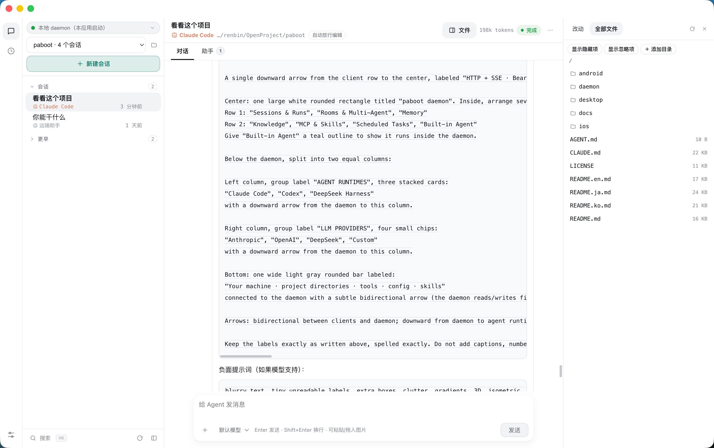
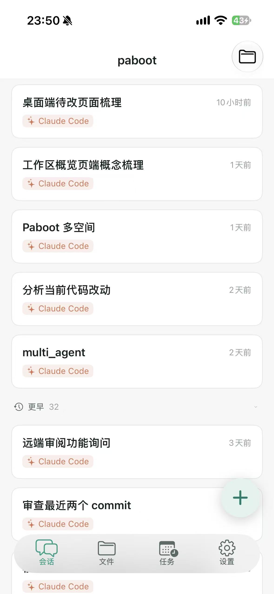
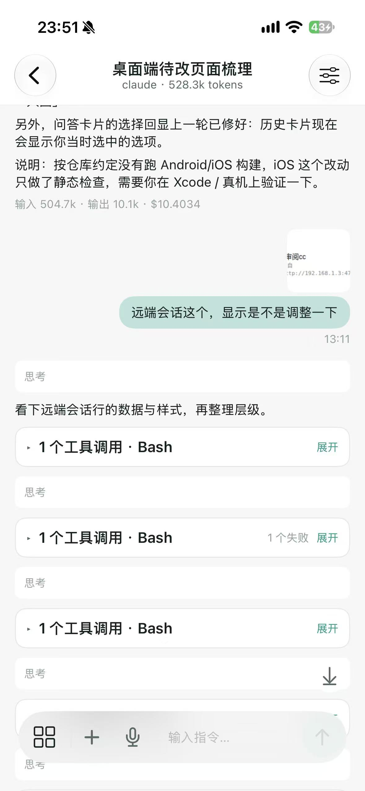
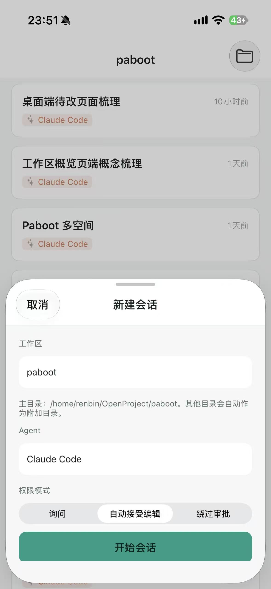
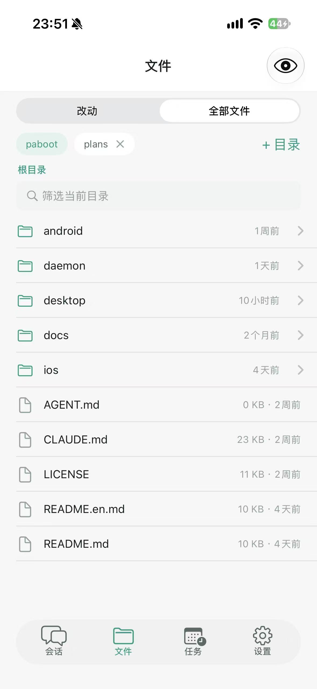
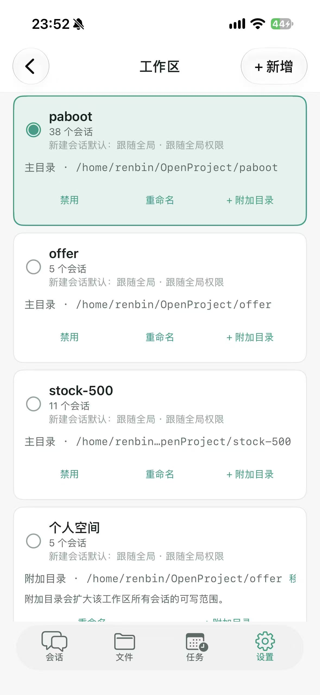
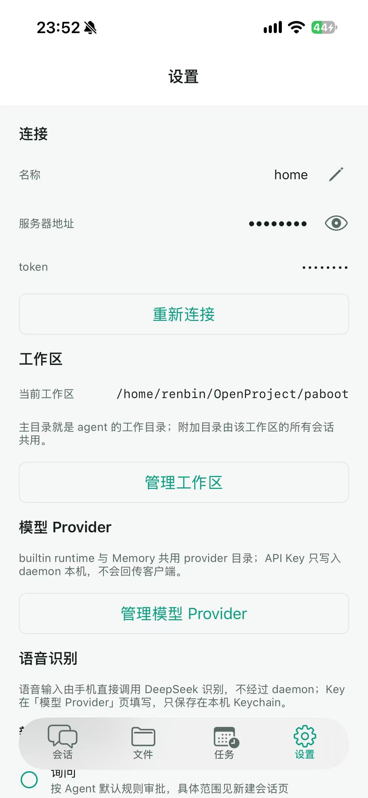

<p align="center">
  <a href="README.en.md">English</a> | <a href="README.md">中文</a> | <a href="README.ja.md">日本語</a> | 한국어
</p>

<h1 align="center">paboot</h1>

<h4 align="center">코딩, 소통, 일상을 위한 퍼스널 에이전트</h4>

<p align="center"><em>Build your personal agent for coding, socializing, and daily life.</em></p>

<p align="center">
  <a href="https://github.com/noResign/paboot/releases/latest"></a>
  <a href="https://www.npmjs.com/package/@noresign/paboot"></a>
  <a href="LICENSE"></a>
  <a href="https://github.com/noResign/paboot/stargazers"></a>
</p>

<p align="center">
  <a href="#빠른-시작">🚀 빠른 시작</a> &nbsp;·&nbsp;
  <a href="daemon/docs/daemon.md">📖 문서</a> &nbsp;·&nbsp;
  <a href="https://github.com/noResign/paboot/releases">💻 다운로드</a> &nbsp;·&nbsp;
  <a href="android/README.md">📱 Android</a> &nbsp;·&nbsp;
  <a href="ios/README.md">🍎 iOS</a> &nbsp;·&nbsp;
  <a href="desktop/README.md">🖥️ 데스크톱</a>
</p>

<br/>

**paboot는 여러분의 컴퓨터에서 실행되는 퍼스널 에이전트입니다**: 하나의 daemon이 여러
에이전트와 여러 모델을 구동하고, 휴대폰, 태블릿, 데스크톱에서 같은 하나에 접속할 수 있습니다.
여러분을 기억하고(메모리), 여러분의 자료를 이해하며(지식), 여러 어시스턴트를 한 대화에
불러 협업시키고(그룹 채팅), 도구와 스킬도 갖추고 있습니다.

**데이터는 항상 여러분의 머신에 있습니다**: 계정 등록이 필요 없고 데이터를 수집하지 않습니다.
세션은 여러분의 컴퓨터에서 실행되며 클라이언트는 입구일 뿐입니다. 연결이 끊겨도 작업은
멈추지 않고, 다시 연결하면 이어서 볼 수 있습니다.

<p align="center">
  
</p>

<p align="center"><em>데스크톱: 활동 표시줄 · 세션 목록 · 대화 · 파일 패널</em></p>

<br/>

## 🌟 하이라이트

| 기능 | 설명 |
| :--- | :--- |
| 멀티 에이전트 | Claude Code, Codex, DeepSeek Harness, 내장 에이전트를 하나의 클라이언트로. 워크스페이스마다 여러 어시스턴트 정의 가능 |
| 그룹 채팅 | 하나의 세션이 하나의 룸. `@`로 응답자를 지정하고 어시스턴트끼리 호출·보고. 머신 간 공유 지원(현재 데스크톱) |
| 메모리 | 대화에서 사실·선호·관계·미완료 작업을 추출하고 중복 제거와 충돌 해결을 거쳐 컨텍스트에 주입 |
| 지식 | 검증 가능한 Markdown 지식 베이스. 검토 상태, 인덱스 검색, 컨텍스트 주입 지원 |
| 도구와 스킬 | 파일, Bash, 웹, 질문, Todo 등 내장 도구. MCP 서버와 스킬 지원 |
| 멀티 모델 | Anthropic / OpenAI / DeepSeek 템플릿과 임의의 OpenAI 호환 제공자. 세션별 전환 |
| 멀티 클라이언트 | Android / iOS / 데스크톱 네이티브 구현. 하나의 프로토콜과 하나의 디자인 시스템 공유 |
| 내장 에이전트 | 외부 CLI 불필요. 모델 API 키 하나면 동작 |
| 끊김 없이 계속 | run과 연결을 분리. 화면 잠금, 앱 전환, 네트워크 끊김에도 컴퓨터의 작업은 멈추지 않음 |
| 승인 | 세션별 `ask` / `acceptEdits` / `bypass`. 기본 거부, 타임아웃 시 자동 거부 |
| 예약 작업 | daemon 내 스케줄링. AI 설정 세션이 작업을 작성하고 cron으로 트리거하여 세션 재개 |
| 파일 변경 | Git 변경 / diff / 디렉터리 트리 / 텍스트·미디어 미리보기. index / HEAD는 건드리지 않음 |
| 어디서나 배포 | 데스크톱은 daemon 내장. npm / Docker로 임의의 컴퓨터나 서버에 배포 가능 |

<br/>

## 빠른 시작

paboot은 여러 가지 방식으로 사용할 수 있습니다. 환경에 맞게 선택하세요:

| 방식 | 적합한 경우 | 진입점 |
| :--- | :--- | :--- |
| **데스크톱(권장)** | Node / CLI 없이 바로 사용 | [설치 파일](https://github.com/noResign/paboot/releases) |
| **daemon + 휴대폰** | 항상 켜 둔 컴퓨터에 휴대폰 / 태블릿으로 접속 | `npm install -g @noresign/paboot` |
| **Docker** | 서버 / NAS에 배포 | [daemon/docker-compose.yml](daemon/docker-compose.yml) |
| **소스에서 빌드** | 개발 참여 | 아래 "클라이언트를 소스에서 빌드" |

### 0. 사전 준비

paboot은 Claude Code / Codex / DeepSeek Harness와 **내장 에이전트**를 지원합니다. 외부
에이전트는 **daemon을 실행하는 머신**에 미리 설치하고 설정해야 합니다. 내장 에이전트는
CLI가 필요 없고 모델 제공자의 API 키만 있으면 됩니다(아래 "멀티 에이전트와 그룹 채팅" 참고).

> [Codex CLI](https://developers.openai.com/codex/cli) and run `codex login`
>
> [Claude Code](https://code.claude.com/docs) and run `claude auth login`
>
> [DeepSeek Harness](https://github.com/deepseek-ai/deepseek-harness)：`npm install -g @deepseek-ai/dsh`；모델 자격 증명은
> `DEEPSEEK_API_KEY` 환경 변수 또는 `dsh web`의 "설정 → 모델"에서 입력합니다.

### 1. 데스크톱(권장: 데스크톱 자체가 daemon을 실행할 수 있습니다)

[releases](https://github.com/noResign/paboot/releases)에서 설치 파일을 내려받아 실행합니다.
데스크톱에는 daemon이 내장되어 있어 로컬에 실행 중인 daemon이 없으면 자동으로 하나를
시작합니다(설정에서 자동 시작을 끌 수 있습니다). **Node / npm을 먼저 설치할 필요가
없습니다.**

- 연결하면 기본으로 내장 "퍼스널" 워크스페이스에 들어갑니다. "설정 → 워크스페이스"에서
  프로젝트 디렉터리를 추가하거나 전환할 수 있습니다;
- 같은 LAN의 Android / iOS도 이 daemon에 연결할 수 있습니다. 주소는 데스크톱에 표시되는
  LAN 주소, token은 `~/.paboot/token`입니다.

### 2. daemon 단독 배포(임의의 컴퓨터 / 서버)

daemon은 HTTP/SSE로 노출되는 헤드리스 백엔드이므로 임의의 머신에 두고 임의의 클라이언트에
제공할 수 있습니다.

**npm**

```bash
npm install -g @noresign/paboot      # 전역 명령 이름은 paboot

paboot --workspace /path/to/your/project
# --workspace를 생략하면 내장 "퍼스널" 워크스페이스(~/.paboot/life)로 들어갑니다
```

- token은 `~/.paboot/token`에 저장됩니다(파일을 삭제하면 회전). `--token`으로 직접 지정할
  수도 있습니다
- 전체 옵션, 설정, HTTP/SSE API는 [daemon/README.md](daemon/README.md)를 참고하세요

**Docker**

```bash
cd daemon
PABOOT_UID=$(id -u) PABOOT_GID=$(id -g) docker compose up -d --build

# 이미지에는 agent CLI가 포함되어 있지 않습니다. 사용할 것을 설치하세요
docker exec -it paboot npm i -g @anthropic-ai/claude-code
docker compose restart daemon
```

- token: `docker exec paboot cat /home/paboot/.paboot/token`
- 호스트 프로젝트 마운트, 인증, 이미지 게시 등의 자세한 내용은
  [daemon/docs/docker.md](daemon/docs/docker.md)를 참고하세요

### 3. 클라이언트를 소스에서 빌드

**(1) desktop**

desktop 빌드는 daemon의 tsc로 프로토콜 타입을 생성하므로 먼저 양쪽 의존성을 설치합니다:

```bash
cd daemon && pnpm install && cd ..
cd desktop && pnpm install    # Electron 바이너리(약 100MB)를 내려받습니다
```

일상 개발과 패키징:

```bash
cd desktop
pnpm dev             # 메인 프로세스 + 렌더러(HMR)
pnpm dist            # 현재 플랫폼 설치 파일을 release/에 생성
pnpm dist:linux      # 또는 dist:mac / dist:windows
```

명령과 빌드 세부 사항은 [desktop/README.md](desktop/README.md)를 참고하세요.

**(2) android**

Android Studio에서 `android/`를 열고 flavor를 선택한 뒤 Run합니다. 명령줄은 다음과
같습니다:

```bash
cd android
./gradlew :app:assembleAlphaDebug
```

채널은 두 개: `alphaDebug`(테스트)와 `prodDebug`(정식). 정식 서명에는
`android/keystore.properties`가 필요합니다. 모듈 구성과 서명 설명은
[android/README.md](android/README.md)를 참고하세요.

**(3) ios**

Xcode에서 `ios/paboot.xcodeproj`를 열고 Run합니다. 명령줄은 다음과 같습니다:

```bash
cd ios
xcodebuild -project paboot.xcodeproj -scheme paboot \
  -destination 'generic/platform=iOS Simulator' build CODE_SIGNING_ALLOWED=NO
```

모듈 구성과 순수 로직 테스트(`ios/PabootCore`)는 [ios/README.md](ios/README.md)를
참고하세요.

<br/>

## 👥 멀티 에이전트와 그룹 채팅

paboot은 "어떤 에이전트가 답할지"를 조합 가능하게 만듭니다. 하나의 세션에 리드 에이전트
하나만 둘 수도 있고, 여러 어시스턴트를 같은 룸에 불러 협업시킬 수도 있습니다.

### 에이전트 런타임

| 런타임 | 연결 방식 | 설명 |
| :--- | :--- | :--- |
| Claude Code | 외부 CLI | 로컬 설치 후 `claude auth login` |
| Codex | 외부 CLI(`codex app-server`) | 로컬 설치 후 `codex login` |
| DeepSeek Harness | 외부 CLI(`dsh acp`) | 로컬 설치 후 모델 자격 증명 설정 |
| 내장 에이전트 | daemon 프로세스 내 | CLI 불필요. 모델 API 키만 |

**내장 에이전트는 바로 사용할 수 있습니다**: daemon 프로세스 안에서 동작하며 도구, MCP,
스킬, 이미지 입력, 컨텍스트 압축을 갖춥니다. 확인이 필요하면 질문 카드를 띄우고 **같은 run
안에서 여러분의 답변을 기다립니다**. 답변하면 이어서 작업을 진행합니다.

### 어시스턴트와 룸

- **워크스페이스 단위 어시스턴트**: 각 워크스페이스에 여러 어시스턴트를 정의할 수 있으며
  각각 runtime, 모델, 시스템 정의, 읽기 전용 제약을 지정합니다. 읽기 전용 어시스턴트에는
  쓰기 도구가 없고, 한 룸에 쓰기 가능한 에이전트는 최대 하나입니다.
- **하나의 세션 = 하나의 룸**: `@이름`으로 응답자를 지정하고 `@all`로 사용 가능한 모든
  멤버에게 브로드캐스트합니다. `@`가 없으면 리드 에이전트가 답합니다. 같은 turn의 여러
  작업은 병렬로 실행되고, 같은 에이전트의 작업은 직렬로 큐에 들어갑니다.
- **제한된 릴레이**: 리드는 답변 끝에서 `@`로 다른 어시스턴트를 호출할 수 있고, 호출된
  어시스턴트는 완료 후 `@`로 리드에게 한 번만 보고할 수 있습니다. 체인에는 상한이 있어
  무한히 `@`하지 않습니다.
- **머신 간 공유**: 초대 링크로 어시스턴트를 다른 paboot에 공유하고, 상대 세션에서 직접
  `@`할 수 있습니다(신뢰할 수 있는 네트워크 전제, 기본 거부).
- **AI 어시스턴트 작성**: 원하는 어시스턴트를 한 문장으로 설명하면 내장 모델이 이름, 요약,
  정의를 생성합니다. 확인 후 생성합니다.

> 그룹 채팅 UI는 현재 데스크톱에서만 제공됩니다. Android / iOS는 아직 단일 에이전트 세션
> 스트림이며 룸 스트림과 `@`를 지원하지 않습니다.

<br/>

## 🧠 메모리와 지식

### 메모리

paboot은 life 세션(및 메모리가 켜진 dev 워크스페이스)에서 대화를 자동으로 수집하고,
백그라운드에서 공유 LLM으로 사실, 선호, 관계, 프로필, 미완료 작업을 추출합니다. 중복 제거,
충돌 해결, 엔티티 통합을 거쳐 예산에 맞춰 컨텍스트에 주입되며, memory 도구로 필요할 때
검색할 수도 있습니다.

- 메모리와 주입은 워크스페이스별로 켜고 끌 수 있습니다. 퍼스널 워크스페이스는 기본 켜짐,
  프로젝트 워크스페이스는 기본 꺼짐입니다.
- 워크스페이스 간 읽기 정책, 검색 사다리, 타임라인과 검색, 후속 항목 검토, 항목별 피드백을
  지원합니다.
- 클라이언트에서 조회·수정·잊기가 가능합니다. 쓰기 도구는 승인을 거칩니다.
- 데이터는 `<dataDir>/memory/memory.db`에 있으며 메인 DB와 분리되어 있고 WAL 모드입니다.

자세한 내용은 [daemon/docs/memory.md](daemon/docs/memory.md)를 참고하세요.

### 지식

워크스페이스의 Markdown 문서가 검증 가능한 지식 베이스를 구성합니다. 각 항목에는 제목, 본문,
`.meta.json` 메타데이터(출처, 검토 상태, 해시)가 있습니다. confirmed 항목은 포인터로
컨텍스트에 주입되고 본문은 필요할 때 읽습니다. zip 내보내기도 지원합니다.

- 워크스페이스 단위로 구성되며 외부 디렉터리를 추가할 수 있습니다. 스캔과 인덱싱은 daemon
  내에서 수행됩니다.
- 데스크톱에서는 생성·편집·검증·삭제가 가능하고, 모바일에서는 조회와 검증 표시만 가능합니다.
  지식 변경은 메모리 인덱스에 동기화됩니다.
- 파일이 원본이며 인덱스는 재구축할 수 있습니다.

자세한 내용은 [daemon/docs/knowledge.md](daemon/docs/knowledge.md)를 참고하세요.

<br/>

## 🔧 도구와 스킬

내장 에이전트는 자체 도구 세트를 갖추고 있으며, 외부 에이전트는 각자의 도구 체인을 계속
사용합니다.

| 분류 | 내용 |
| :--- | :--- |
| 파일 | `Read` / `Write` / `Edit` / `Grep` / `Glob` |
| 터미널 | `Bash`(읽기 전용 허용 목록은 자동 허용, 쓰기는 승인) |
| 웹 | `WebSearch`(제공자 측) / `WebFetch`(제공자 측 또는 로컬 직접 연결 2백엔드) |
| 상호작용 | `AskUserQuestion`(블로킹 질문) / `TodoWrite` |
| 확장 | MCP 서버(stdio), 스킬(`SKILL.md` 디렉터리), 이미지 입력 |

- **MCP**: run마다 `ToolServerSpec`을 구성해 Claude / Codex / DeepSeek / builtin에 각각
  주입합니다. 승인이 필요한 서버는 공통 게이트를 통과합니다.
- **스킬**: 워크스페이스와 내장 디렉터리에서 `SKILL.md`를 필요할 때 읽어 컨텍스트를 한 번에
  채우지 않습니다.
- **권한**: 모든 도구 호출은 `PermissionManager`를 거칩니다. 읽기 계열은 게이트되지 않고,
  쓰기 계열은 `ask` / `acceptEdits`에서 승인이 필요하며 타임아웃 시 거부됩니다.

<br/>

## 🤖 모델

내장 에이전트는 공유 `llm/` 레이어를 통해 모델을 호출합니다. 같은 제공자 카탈로그는 메모리
추출, 어시스턴트 작성 등 백그라운드 작업에도 사용됩니다.

| 제공자 | 내장 모델 | 자격 증명 |
| :--- | :--- | :--- |
| Anthropic | Claude Sonnet 4.6 | `ANTHROPIC_API_KEY` |
| OpenAI | GPT-5.2 | `OPENAI_API_KEY` |
| DeepSeek | DeepSeek Flash / Chat / Reasoner | `DEEPSEEK_API_KEY` |
| 사용자 지정 | 임의의 OpenAI 호환 모델 | `~/.paboot/providers.json` 또는 `PABOOT_LLM_PROVIDERS` |

- 세션별로 모델을 선택할 수 있습니다. 외부 에이전트의 모델은 각 CLI 설정을 따릅니다.
- 카탈로그는 전체 교체하거나 제공자를 추가할 수 있습니다. 키는 쓰기 전용이며 클라이언트로
  반환되지 않습니다.
- 이미지와 도구 호출 지원은 모델별로 선언됩니다. `@`로 지정된 에이전트 중 하나라도 이미지를
  받을 수 없으면 사용자 메시지를 쓰기 전에 turn 전체가 거부됩니다.

<br/>

## 📱 클라이언트

세 클라이언트 모두 네이티브 구현이며 `daemon/src/types/api.ts`의 전송 계약과 `docs/ui/`의
디자인 시스템을 공유합니다.

| 클라이언트 | 기술 스택 | 구현됨 |
| :--- | :--- | :--- |
| Android | Kotlin + Jetpack Compose | 연결 / 세션 / 채팅 / 승인 / 파일 / 워크스페이스 / 예약 작업 / 지식(조회 / 검증) / 메모리 |
| iOS | UIKit + SwiftPM | 연결 / 세션 / 채팅 / 승인 / 파일 / 워크스페이스 / 예약 작업 / 지식(조회 / 검증) / 메모리 |
| 데스크톱 | Electron + React | 위 기능 + 멀티 에이전트 그룹 채팅 / 어시스턴트 관리 / 전역 작업 / 머신 간 공유 / 스킨 |

### 모바일 UI

| 세션 목록 | 채팅(Markdown 렌더링) | 새 세션 |
|---|---|---|
|  |  |  |

| Diff / 모든 파일 | 워크스페이스 관리 | 설정 |
|---|---|---|
|  |  |  |

<br/>

## 🔐 보안과 권한

클라이언트에서 shell 권한을 가진 에이전트를 구동하는 것은 사실상 원격 코드 실행입니다.
paboot의 기본값은 "거부"입니다:

- **인증**: `/health`와 peer의 공개 핸드셰이크 엔드포인트를 제외한 모든 라우트에 Bearer
  token이 필요합니다. token은 `~/.paboot/token`에 저장되며 파일을 삭제하면 회전됩니다.
  같은 출처에서 연속 실패하면 쿨다운이 적용됩니다.
- **권한 모드**: 세션별 `ask` / `acceptEdits` / `bypass`. `ask`에서는 Bash / Write / Edit과
  MCP 호출에 승인이 필요하고 타임아웃 시 자동 거부되며, 읽기 전용 명령은 자동 허용됩니다.
- **범위**: 승인과 "모두 허용"은 세션 단위입니다. 워크스페이스 경계는 쓰기를 제한할 뿐 OS
  샌드박스가 아닙니다. 워크스페이스 밖 읽기는 승인도 필요 없고 디렉터리도 자동 추가되지
  않습니다.
- **데이터**: SQLite / token / 메모리 / 지식 / providers는 `~/.paboot` 아래에 있습니다.
  paboot은 계정이 필요 없고 데이터를 수집하지 않습니다.
- **머신 간**: peer는 "신뢰할 수 있는 상대" 모드입니다. `~/.paboot`은 샌드박스가 아니라
  최선 노력으로 거부합니다. 공유할 수 있는 것은 builtin / Claude 에이전트뿐입니다.

> ⚠️ daemon을 인터넷에 노출하는 것은 shell을 가진 머신을 연결할 수 있는 사람에게 넘기는
> 것과 같습니다. Tailscale / ZeroTier / WireGuard 같은 메시 네트워크를 우선하고, SSH
> 터널은 임시 개인 용도로만 사용하세요. IP와 token을 노출하지 마세요.

<br/>

## 🌐 원격 접속(선택)

daemon은 기본적으로 LAN만 수신합니다. 휴대폰과 컴퓨터가 같은 네트워크에 없을 때는 주로 두
가지 방법이 있습니다:

**(1) SSH 릴레이** —— 자용에 적합합니다. 공인 IP를 가진 서버가 하나 필요합니다. **daemon을
실행하는 컴퓨터**에서 다음을 실행합니다:

```bash
ssh -N -R 0.0.0.0:4788:localhost:4780 user@your-server
```

그다음 휴대폰에서 `http://your-server:4788`에 연결합니다. 주의: **SSH가 암호화하는 것은
"컴퓨터 → 서버" 구간뿐이고, 휴대폰에서 서버로 가는 구간은 여전히 평문 HTTP**입니다. 그
구간에서는 token이 평문으로 흐르므로 임시 사용에만 한정하세요.

- `-R`은 기본적으로 서버의 **loopback**에만 바인딩합니다. 서버의
  `/etc/ssh/sshd_config`에서 `GatewayPorts clientspecified`를 설정하세요
- 터널은 자동으로 복구되지 않습니다. systemd 서비스로 상주시키거나
  `autossh -M 0 -N -R ...`를 사용하세요

**(2) 메시 / VPN 도구** —— 컴퓨터와 휴대폰을 같은 가상 네트워크에 넣으면 같은 LAN에 있는
것처럼 daemon이 표시한 주소(또는 가상 IP)로 그대로 연결할 수 있습니다. daemon 쪽 설정
변경은 필요 없습니다:

- **Tailscale / ZeroTier** —— 설치하고 로그인하면 끝. NAT 통과에 실패하면 자동으로 릴레이
- **WireGuard** —— 직접 구축. 가장 깔끔하지만 키와 라우트를 관리해야 합니다

경로 전체가 암호화되므로 인증서나 포트 노출을 걱정할 필요가 없습니다.

<br/>

## 🛠️ 개발과 기여

- 저장소 구조와 개발 규칙은 [CLAUDE.md](CLAUDE.md)를 참고하세요. 각 하위 프로젝트의 세부
  사항은 각 README에 있습니다.
- daemon: `cd daemon && pnpm install && pnpm dev`. 커밋 전에
  `pnpm typecheck && pnpm test`를 실행하세요.
- 데스크톱: `cd desktop && pnpm dev`. Android는 Android Studio, iOS는 Xcode에서
  `ios/paboot.xcodeproj`를 엽니다.
- 프로토콜과 관련된 변경은 `daemon/src/types/api.ts`와 세 클라이언트의 DTO를 동기화하세요.
  Issue / PR을 환영합니다.

<br/>

## ⚠️ 면책 조항

1. 이 프로젝트는 [Apache-2.0](LICENSE)으로 공개되며, 있는 그대로 제공되고 어떠한 보증도
   없습니다.
2. 에이전트는 로컬 파일 시스템과 shell에 접근할 수 있습니다. 신뢰할 수 있는 환경에서만
   배포하고 자기 책임으로 사용하세요.
3. 거주 지역의 법률과 규정을 준수하세요. 이 프로젝트 사용으로 인해 발생하는 결과에 대해
   유지 관리자는 책임을 지지 않습니다.

<br/>

## License

Apache-2.0 — [LICENSE](LICENSE)를 참조하세요.
