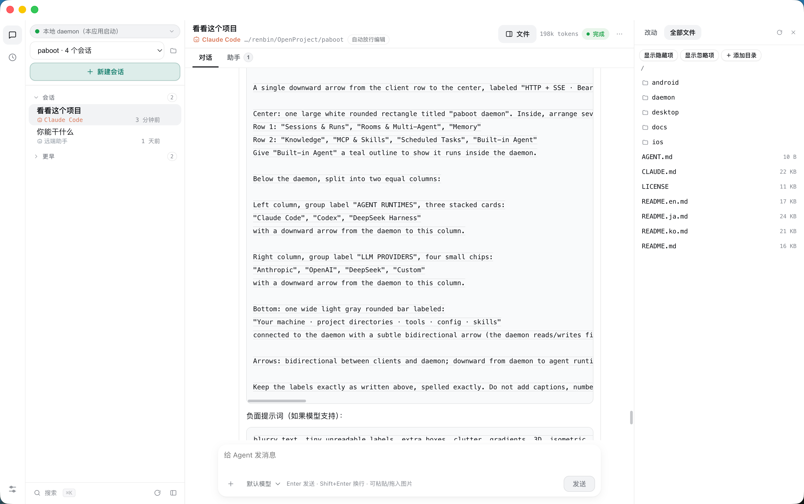
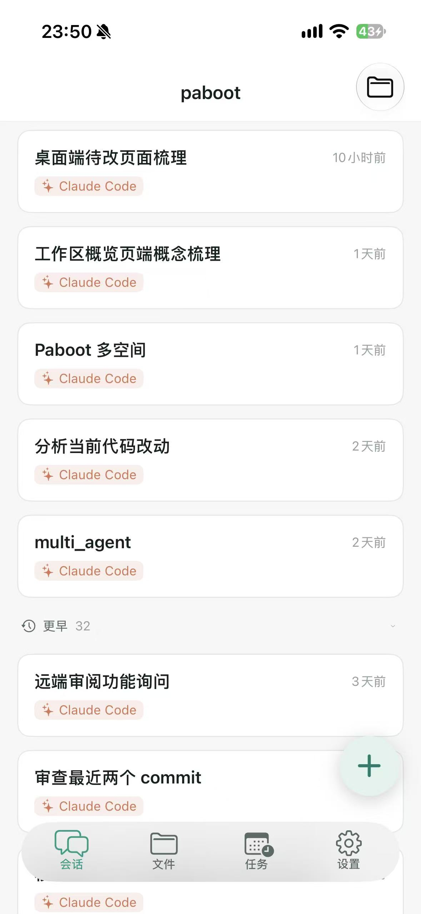
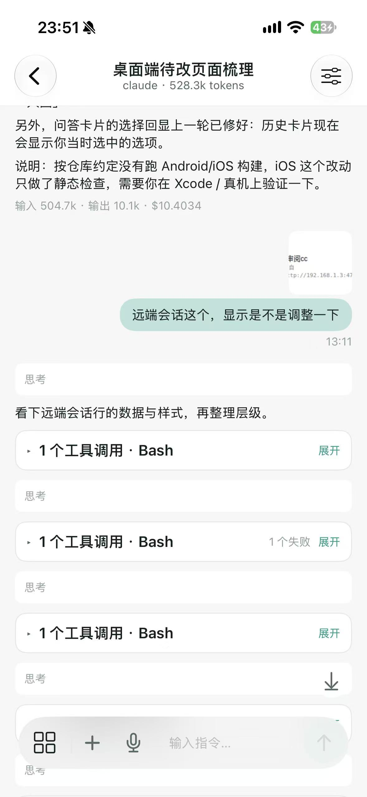
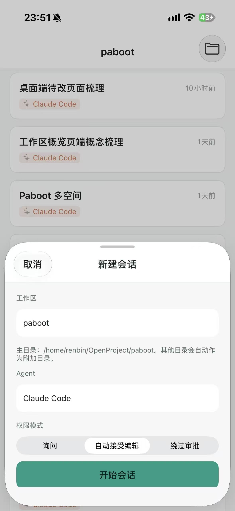
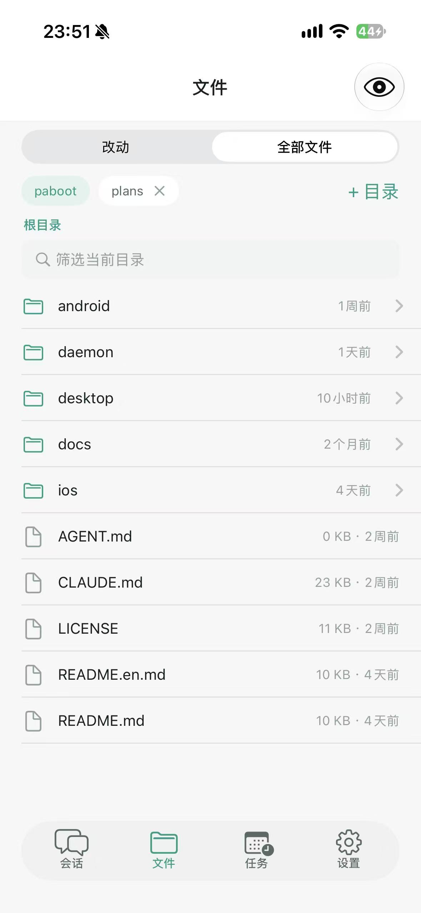
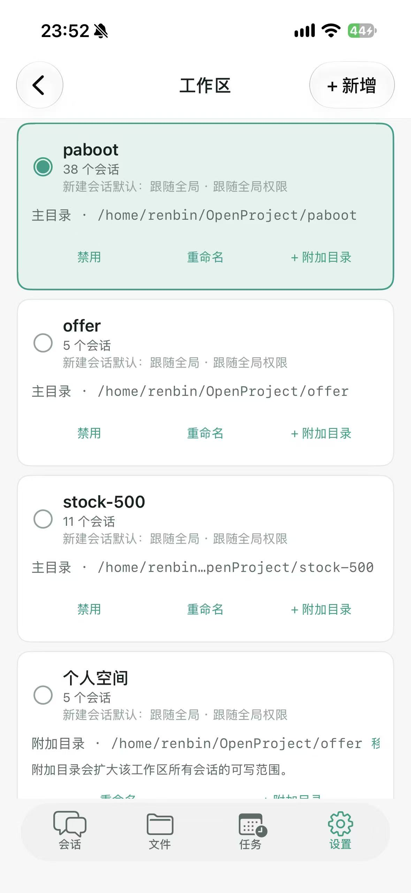
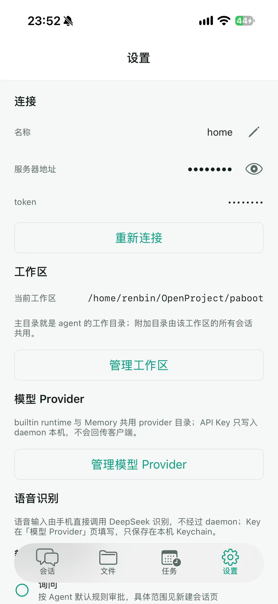

<p align="center">
  <a href="README.en.md">English</a> | 中文 | <a href="README.ja.md">日本語</a> | <a href="README.ko.md">한국어</a>
</p>

<h1 align="center">paboot</h1>

<h4 align="center">打造你的个人助理，用于编码、社交与生活</h4>

<p align="center"><em>Build your personal agent for coding, socializing, and daily life.</em></p>

<p align="center">
  <a href="https://github.com/noResign/paboot/releases/latest"></a>
  <a href="https://www.npmjs.com/package/@noresign/paboot"></a>
  <a href="LICENSE"></a>
  <a href="https://github.com/noResign/paboot/stargazers"></a>
</p>

<p align="center">
  <a href="#快速开始">🚀 快速开始</a> &nbsp;·&nbsp;
  <a href="daemon/docs/daemon.md">📖 文档</a> &nbsp;·&nbsp;
  <a href="https://github.com/noResign/paboot/releases">💻 下载</a> &nbsp;·&nbsp;
  <a href="android/README.md">📱 Android</a> &nbsp;·&nbsp;
  <a href="ios/README.md">🍎 iOS</a> &nbsp;·&nbsp;
  <a href="desktop/README.md">🖥️ 桌面端</a>
</p>

<br/>

**paboot 是跑在你自己电脑上的 personal agent**：可驱动多种 agent、多种模型，
手机、平板和桌面随时接入同一个它。它记得你（记忆）、懂你的资料（知识）、能把多个助手拉进
同一个会话协作（群聊），也自带工具与 Skill。**数据始终在你自己的机器上**：开源，不注册账号，
不收集任何数据；会话跑在你的电脑上。

<p align="center">
  
</p>

<p align="center"><em>桌面端：活动栏 · 会话列表 · 主区对话 · 右侧文件栏</em></p>

<br/>

## 🌟 Highlights

| 能力 | 说明 |
| :--- | :--- |
| 多 Agent | Claude Code、Codex、DeepSeek Harness 与内置 agent 统一接入；工作区里可定义多个助手 |
| 群聊协作 | 一个会话就是一个房间：`@` 谁谁来答，助手之间可召唤、回报，支持跨机共享（桌面端已支持） |
| 记忆 | 从对话中自动沉淀事实 / 偏好 / 关系 / 待办，经去重与冲突裁决后注入上下文 |
| 知识 | 可核验的 Markdown 知识库，带审阅状态、索引检索与上下文注入 |
| 工具与 Skill | 文件、Bash、网络、提问、Todo 等内置工具，支持 MCP server 与 Skill |
| 多模型 | Anthropic / OpenAI / DeepSeek 内置模板，任意 OpenAI 兼容 provider，按会话切换 |
| 多客户端 | Android / iOS / 桌面原生实现，共用一份协议与一套设计规范 |
| 内置 agent | 不用装任何外部 CLI，一个模型 API Key 就能跑 |
| 断线续传 | run 与连接解耦，锁屏、切后台、断网都不影响电脑上的任务 |
| 权限审批 | 每个会话独立 `ask` / `acceptEdits` / `bypass`，默认拒绝、超时自动拒绝 |
| 定时任务 | daemon 内调度，AI 配置会话起草任务，按 cron 触发并续接会话 |
| 文件改动 | Git 改动 / diff / 目录树 / 文本与媒体预览；不碰你的 index / HEAD |
| 任意部署 | 桌面端内置 daemon；也可 npm / Docker 部署到任意电脑或服务器 |

<br/>

## 快速开始

paboot 有几种用法，按你的场景选：

| 方式 | 适合 | 入口 |
| :--- | :--- | :--- |
| **桌面端（推荐）** | 开箱即用，不想装 Node / CLI | [下载安装包](https://github.com/noResign/paboot/releases) |
| **daemon + 手机** | 电脑长期在线，手机 / 平板随时接入 | `npm install -g @noresign/paboot` |
| **Docker** | 部署在服务器 / NAS | [daemon/docker-compose.yml](daemon/docker-compose.yml) |
| **从源码构建** | 参与开发 | 见下文「从源码构建客户端」 |

### 0. 前置

paboot 支持 Claude Code / Codex / DeepSeek Harness，以及**内置 agent**。外部 agent 需要在
**运行 daemon 的那台机器**上先安装并配置；内置 agent 不需要装任何 CLI，只要给它一个模型
provider 的 API Key 即可（见下文「多 Agent 与群聊」）。

> [Codex CLI](https://developers.openai.com/codex/cli) and run `codex login`
>
> [Claude Code](https://code.claude.com/docs) and run `claude auth login`
>
> [DeepSeek Harness](https://github.com/deepseek-ai/deepseek-harness)：`npm install -g @deepseek-ai/dsh`；模型凭据用
> `DEEPSEEK_API_KEY` 环境变量，或在 `dsh web` 的「设置 → 模型」里填写。

### 1. 桌面端（推荐：桌面端可以直接运行 daemon）

从 [releases](https://github.com/noResign/paboot/releases) 下载安装包并打开。桌面端内置 daemon：
本机没有正在运行的 daemon 时会自动启动一个（设置里可关闭自动启动），**不需要先装 Node / npm**。

- 连上后默认进入内置「个人空间」工作区；在「设置 → 工作区」添加或切换项目目录；
- 同一个局域网里的 Android / iOS 也能连这个 daemon：地址用桌面端显示的局域网地址，token 在
  `~/.paboot/token`。

### 2. 独立部署 daemon（任意电脑 / 服务器）

daemon 是无界面的后端，通过 HTTP/SSE 对外，因此可以装在任意一台机器上，供任意客户端连接。

**npm**

```bash
npm install -g @noresign/paboot      # 全局命令名是 paboot

paboot --workspace /path/to/your/project
# 不传 --workspace 时，默认进入内置「个人空间」工作区（~/.paboot/life）
```

- token 持久化在 `~/.paboot/token`，删掉即轮换；也可以用 `--token` 自己指定
- 完整参数、配置项与 HTTP/SSE 接口见 [daemon/README.md](daemon/README.md)

**Docker**

```bash
cd daemon
PABOOT_UID=$(id -u) PABOOT_GID=$(id -g) docker compose up -d --build

# 镜像不含 agent CLI，用哪个装哪个
docker exec -it paboot npm i -g @anthropic-ai/claude-code
docker compose restart daemon
```

- token：`docker exec paboot cat /home/paboot/.paboot/token`
- 挂载宿主机项目、认证、发布镜像等完整说明见 [daemon/docs/docker.md](daemon/docs/docker.md)

### 3. 从源码构建客户端

**(1) desktop**

```bash
cd daemon && pnpm install && cd ..
cd desktop && pnpm install
```

命令与构建细节见 [desktop/README.md](desktop/README.md)。

**(2) android**

```bash
cd android
./gradlew :app:assembleAlphaDebug
```

两个通道：`alphaDebug`（测试）与 `prodDebug`（正式）；正式签名需要
`android/keystore.properties`。模块划分与签名说明见
[android/README.md](android/README.md)。

**(3) ios**

```bash
cd ios
xcodebuild -project paboot.xcodeproj -scheme paboot \
  -destination 'generic/platform=iOS Simulator' build CODE_SIGNING_ALLOWED=NO
```

模块划分与纯逻辑测试（`ios/PabootCore`）见 [ios/README.md](ios/README.md)。

<br/>

## 👥 多 Agent 与群聊

paboot 把「用哪个 agent」做成可组合的：同一个会话里可以只有一个主答 agent，也可以把多个
助手拉进来协作。

### Agent 运行时

| Runtime | 接入方式 | 说明 |
| :--- | :--- | :--- |
| Claude Code | 外部 CLI | 本机安装并 `claude auth login` |
| Codex | 外部 CLI（`codex app-server`） | 本机安装并 `codex login` |
| DeepSeek Harness | 外部 CLI（`dsh acp`） | 本机安装并配置模型凭据 |
| 内置 agent | daemon 进程内 | 不需要 CLI，只依赖模型 API Key |

**内置 agent 开箱即用**：它跑在 daemon 进程里，自带工具、MCP、Skill、图片输入与上下文压缩。

### 助手与群聊

- **工作区级助手**：每个工作区可以定义多个助手，各自指定 runtime、模型、系统定义与只读约束；
  只读助手不挂写工具，一个房间最多一个可写 agent。
- **支持群聊**：`@名字` 指定谁来答，`@all` 广播给所有可用成员，不 `@` 则由主答
  agent 回答；同一 turn 的多个任务并发跑，同一 agent 的任务串行排队。
- **跨机共享**：把助手通过邀请链接共享给另一台 paboot，对方可以在自己的会话里直接 `@` 它
  （基于可信网络，默认拒绝）。

<br/>

## 🧠 记忆与知识

### 记忆

paboot 会从 life 会话（以及开启记忆的 dev 工作区）里自动捕获对话，后台用共享 LLM 抽取事实、
偏好、关系、画像与待办，经过去重、冲突裁决与实体归一后，按预算注入上下文，也可以通过 memory
工具按需检索。

- 每个工作区独立开关记忆与注入；个人空间默认开启，项目工作区默认关闭。
- 支持跨工作区读取策略、检索阶梯、时间线与搜索、跟进项审核与单条反馈。
- 客户端可查看、改正、忘记；写入工具走审批。

详见 [daemon/docs/memory.md](daemon/docs/memory.md)。

### 知识

工作区里的 Markdown 文档构成一份可核验的知识库：每条知识有标题、正文与 `.meta.json` 元数据，
带来源、审阅状态与哈希。confirmed 的知识会以指针注入上下文，正文按需读取，也支持导出 zip。

- 按工作区组织，可附加外部目录；扫描与索引都在 daemon 内完成。
- 桌面端可新建、编辑、核验、删除；移动端可查看与标记核验。知识变更会同步到记忆索引。
- 文件是真源，索引可重建。

详见 [daemon/docs/knowledge.md](daemon/docs/knowledge.md)。

<br/>

## 🔧 工具与 Skill

内置 agent 自带一组工具，外部 agent 继续使用它们自己的工具链。

| 类别 | 内容 |
| :--- | :--- |
| 文件 | `Read` / `Write` / `Edit` / `Grep` / `Glob` |
| 终端 | `Bash`（只读白名单自动放行，写操作走审批） |
| 网络 | `WebSearch`（服务商侧）/ `WebFetch`（服务商侧或本机直连双后端） |
| 交互 | `AskUserQuestion`（阻塞式提问） / `TodoWrite` |
| 扩展 | MCP server（stdio）、Skill（`SKILL.md` 目录）、图片输入 |

<br/>

## 📱 客户端

三端都是原生实现，共用 `daemon/src/types/api.ts` 的传输契约与 `docs/ui/` 的设计规范。

| 客户端 | 技术栈 | 已实现 |
| :--- | :--- | :--- |
| Android | Kotlin + Jetpack Compose | 连接 / 会话 / 聊天 / 审批 / 文件 / 工作区 / 定时任务 / 知识（查看 / 核验）/ 记忆 |
| iOS | UIKit + SwiftPM | 连接 / 会话 / 聊天 / 审批 / 文件 / 工作区 / 定时任务 / 知识（查看 / 核验）/ 记忆 |
| 桌面端 | Electron + React | 上述能力 + 多 agent 群聊 / 助手管理 / 全局任务 / 跨机共享 / 皮肤系统 |

### 移动端界面

| 会话列表 | 聊天（支持 Markdown） | 新建会话 |
|---|---|---|
|  |  |  |

| Diff / 全部文件 | 工作区管理 | 设置 |
|---|---|---|
|  |  |  |

<br/>

## 🔐 安全与权限

从客户端驱动一个带 shell 权限的 agent，本质等于远程代码执行。paboot 的默认值是「拒绝」：

- **认证**：除 `/health` 与 peer 的公开握手端点外，所有路由都要 Bearer token；token 持久化在
  `~/.paboot/token`，删掉即轮换；同一来源连续失败会冷却。
- **权限模式**：每个会话独立 `ask` / `acceptEdits` / `bypass`；`ask` 下 Bash / Write / Edit
  与 MCP 调用需要审批，超时自动拒绝，只读命令自动放行。
- **作用域**：审批与「允许全部」是 Session 级；工作区边界约束写入，不是 OS 沙箱。读工作区外
  不审批，也不自动加目录。
- **数据**：SQLite / token / 记忆 / 知识 / providers 都在 `~/.paboot`；paboot 不要账号，不收集数据。
- **跨机**：peer 是「可信对端」模式，`~/.paboot` 做尽力拒绝而非沙箱；只共享 builtin / Claude agent。

> ⚠️ 任何把 daemon 暴露到公网的做法，都等于把一台带 shell 的机器交给能连上它的人。
> 优先用 Tailscale / ZeroTier / WireGuard 组网；SSH 隧道只适合临时自用。不要泄露 IP 与 token。

<br/>

## 🌐 远程访问（可选）

daemon 默认监听局域网。手机电脑不在同一个局域网时，有两种常见做法：

**(1) SSH 中转** —— 适合自用，需要一台公网服务器，在**跑 daemon 的电脑**上执行：

```bash
ssh -N -R 0.0.0.0:4788:localhost:4780 user@your-server
```

然后手机连 `http://your-server:4788`。注意：**SSH 只加密了「电脑 → 服务器」这一段，手机到
服务器那一跳仍是明文 HTTP**，token 在这段上等于裸奔——只适合临时用。

- `-R` 默认只在服务器的 **loopback** 上监听；需要在服务器 `/etc/ssh/sshd_config` 里设
  `GatewayPorts clientspecified`
- 隧道断了不会自愈，做成 systemd 服务常驻或用 `autossh -M 0 -N -R ...`

**(2) 组网工具** —— 把电脑和手机加进同一个虚拟内网，之后就像在同一个 LAN 里一样，直接用
daemon 打印的地址（或虚拟网 IP）连接，daemon 侧不用改任何配置。

- **Tailscale / ZeroTier** —— 装好登录即用，打不通 NAT 时自动走中继
- **WireGuard** —— 自己搭，最干净，但要维护密钥与路由

好处是**整条链路本来就是加密的**，不用再操心证书和端口暴露。

<br/>

## 🛠️ 开发与贡献

- 仓库结构与开发约定见 [CLAUDE.md](CLAUDE.md)；各子项目细节见各自的 README。
- daemon：`cd daemon && pnpm install && pnpm dev`，提交前跑 `pnpm typecheck && pnpm test`。
- 桌面端：`cd desktop && pnpm dev`；Android 用 Android Studio；iOS 用 Xcode 打开
  `ios/paboot.xcodeproj`。
- 改动涉及协议时，同步 `daemon/src/types/api.ts` 与三端 DTO。欢迎 Issue / PR。

<br/>

## ⚠️ 免责声明

1. 本项目以 [Apache-2.0](LICENSE) 发布，按现状提供，不附带任何担保。
2. Agent 可以访问本机文件系统与 shell，请只在可信环境中部署，并自行承担使用风险。
3. 请遵守你所在地区的法律法规；因使用本项目产生的后果由使用者自行承担。

<br/>

## License

Apache-2.0，见 [LICENSE](LICENSE)。
